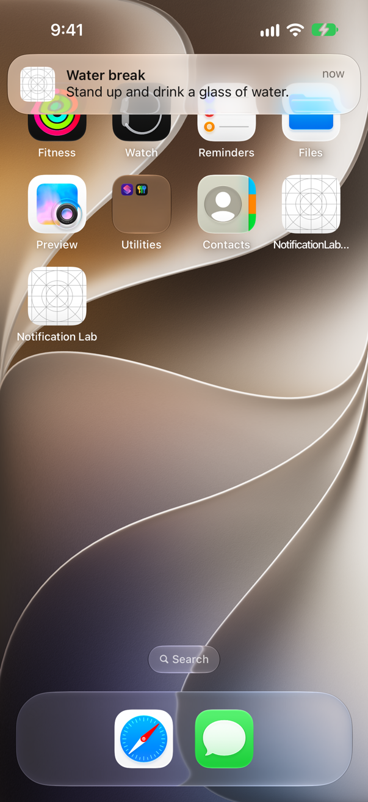
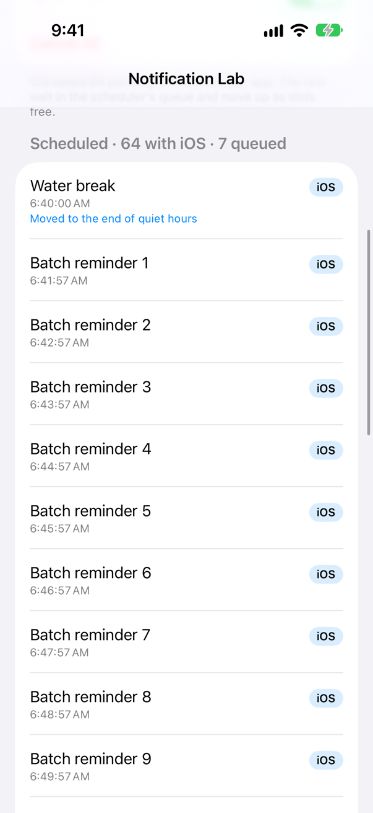
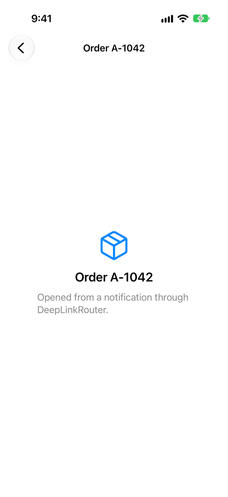
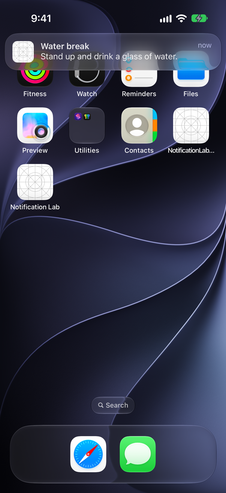
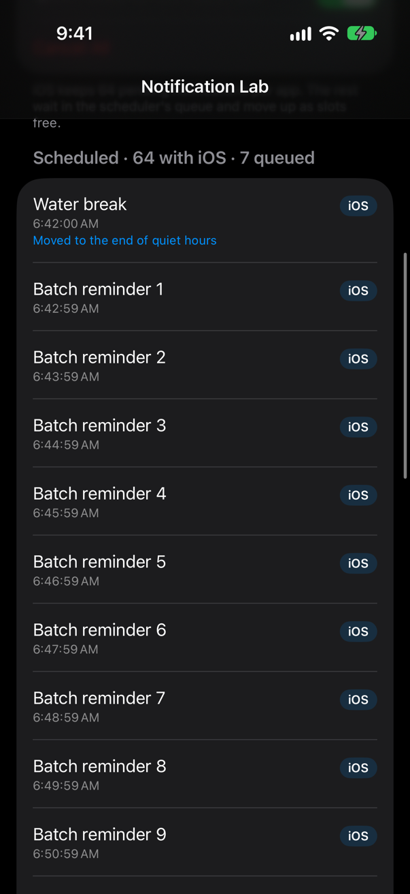
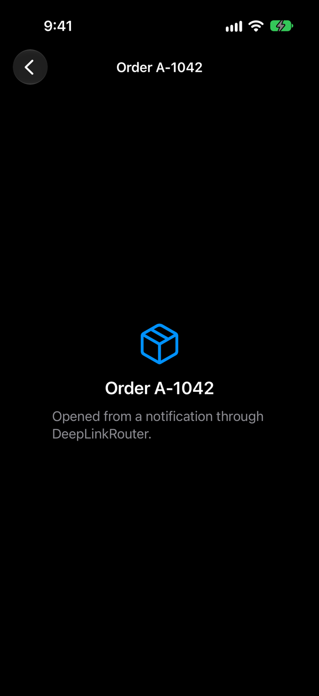

<!-- i18n-source: README.md@3e5602b25e123d445fd60722eaff734a9354ff87 status=reviewed -->
<!-- brand:start -->

<p align="center"><picture><source media="(prefers-color-scheme: dark)" srcset="https://raw.githubusercontent.com/muhittincamdali/iOS-Notification-Framework/main/.github/brand/banner-dark.svg"><source media="(prefers-color-scheme: light)" srcset="https://raw.githubusercontent.com/muhittincamdali/iOS-Notification-Framework/main/.github/brand/banner-light.svg"></picture></p>

<!-- lang-selector:start -->
<p align="center"><a href="README.md">English</a> · <a href="README.tr.md">Türkçe</a> · <a href="README.zh-CN.md">简体中文</a> · <a href="README.ja.md">日本語</a> · <a href="README.ko.md">한국어</a> · <a href="README.es.md">Español</a> · <a href="README.de.md">Deutsch</a> · <a href="README.fr.md">Français</a> · <a href="README.pt-BR.md">Português (Brasil)</a> · <a href="README.ru.md">Русский</a></p>
<!-- lang-selector:end -->

<p align="center">
<a href="https://github.com/muhittincamdali/iOS-Notification-Framework/actions/workflows/ci.yml"></a>
<a href="https://github.com/muhittincamdali/iOS-Notification-Framework/releases"><picture><source media="(prefers-color-scheme: dark)" srcset="https://raw.githubusercontent.com/muhittincamdali/iOS-Notification-Framework/main/.github/brand/badge-version-dark.svg"><source media="(prefers-color-scheme: light)" srcset="https://raw.githubusercontent.com/muhittincamdali/iOS-Notification-Framework/main/.github/brand/badge-version-light.svg"></picture></a>
<a href="https://github.com/muhittincamdali/iOS-Notification-Framework/blob/main/Package.swift"><picture><source media="(prefers-color-scheme: dark)" srcset="https://raw.githubusercontent.com/muhittincamdali/iOS-Notification-Framework/main/.github/brand/badge-platforms-dark.svg"><source media="(prefers-color-scheme: light)" srcset="https://raw.githubusercontent.com/muhittincamdali/iOS-Notification-Framework/main/.github/brand/badge-platforms-light.svg"></picture></a>
<a href="https://github.com/muhittincamdali/iOS-Notification-Framework/blob/main/Package.swift"><picture><source media="(prefers-color-scheme: dark)" srcset="https://raw.githubusercontent.com/muhittincamdali/iOS-Notification-Framework/main/.github/brand/badge-language-dark.svg"><source media="(prefers-color-scheme: light)" srcset="https://raw.githubusercontent.com/muhittincamdali/iOS-Notification-Framework/main/.github/brand/badge-language-light.svg"></picture></a>
<a href="https://github.com/muhittincamdali/iOS-Notification-Framework/blob/main/LICENSE"><picture><source media="(prefers-color-scheme: dark)" srcset="https://raw.githubusercontent.com/muhittincamdali/iOS-Notification-Framework/main/.github/brand/badge-license-dark.svg"><source media="(prefers-color-scheme: light)" srcset="https://raw.githubusercontent.com/muhittincamdali/iOS-Notification-Framework/main/.github/brand/badge-license-light.svg"></picture></a>
</p>

<p align="center">
<a href="#schnellstart"><picture><source media="(prefers-color-scheme: dark)" srcset="https://raw.githubusercontent.com/muhittincamdali/iOS-Notification-Framework/main/.github/brand/button-start-de-dark.svg"><source media="(prefers-color-scheme: light)" srcset="https://raw.githubusercontent.com/muhittincamdali/iOS-Notification-Framework/main/.github/brand/button-start-de-light.svg"></picture></a>
<a href="https://muhittincamdali.github.io/iOS-Notification-Framework/documentation/notificationkit/"><picture><source media="(prefers-color-scheme: dark)" srcset="https://raw.githubusercontent.com/muhittincamdali/iOS-Notification-Framework/main/.github/brand/button-docs-de-dark.svg"><source media="(prefers-color-scheme: light)" srcset="https://raw.githubusercontent.com/muhittincamdali/iOS-Notification-Framework/main/.github/brand/button-docs-de-light.svg"></picture></a>
<a href="https://github.com/muhittincamdali/iOS-Notification-Framework/tree/main/Examples"><picture><source media="(prefers-color-scheme: dark)" srcset="https://raw.githubusercontent.com/muhittincamdali/iOS-Notification-Framework/main/.github/brand/button-examples-de-dark.svg"><source media="(prefers-color-scheme: light)" srcset="https://raw.githubusercontent.com/muhittincamdali/iOS-Notification-Framework/main/.github/brand/button-examples-de-light.svg"></picture></a>
</p>

> Dies ist eine Übersetzung der englischen README. Bei Abweichungen gilt die englische Fassung.

<!-- brand:end -->

NotificationKit ist ein Swift-Paket für Apps, die Benachrichtigungen auf dem Gerät planen, und für die Server, die ihnen Pushes senden. Es verpackt `UserNotifications` in Werttypen und behebt die Stellen, an denen es stillschweigend scheitert: iOS behält von den ausstehenden Benachrichtigungen einer App nur die 64 nächsten und verwirft den Rest ohne Fehlermeldung, manche ungültigen Werte bringen die App zum Absturz, statt einen Fehler zu werfen, und die Delegate-Callbacks lassen sich nur schwer mit Swift concurrency verwenden. Eine zweite Bibliothek, `NotificationKitAPNs`, sendet Pushes über Apples APNs-Dienst von einem Server oder einem Skript aus und nutzt dabei denselben Payload-Typ, den auch die App liest. Keine der beiden Bibliotheken hat Abhängigkeiten außerhalb von Apples SDK.

## Highlights

- **Keine verlorenen Benachrichtigungen jenseits der 64** — `NotificationScheduler` übergibt iOS die 64 nächsten Benachrichtigungen, hält die übrigen in einer gespeicherten Warteschlange und lässt sie nachrücken, sobald Plätze frei werden.
- **Ruhezeiten und eine Frequenzbegrenzung** — geprüft wird gegen den Zeitpunkt, zu dem eine Benachrichtigung ausgelöst wird: Eine um 21:00 Uhr für 23:00 Uhr gesetzte Erinnerung wartet bis zum Morgen, und eine vierte Benachrichtigung innerhalb einer Stunde rückt auf den ersten erlaubten Zeitpunkt.
- **Fehler statt Abstürze** — ein Wiederholungsintervall unter 60 Sekunden, ein NaN-Relevance-Score oder die Stunde 25 werfen einen `NotificationValidationError`, bevor `UNUserNotificationCenter` sie sieht.
- **Taps, Aktionen und Deep Links als Werte** — `NotificationEventHandler` macht aus den Delegate-Callbacks `AsyncStream`s, und `DeepLinkRouter` öffnet Bildschirme nur über die Schemes und Hosts, die du erlaubst.
- **Push auf beiden Seiten** — ein typisierter `PushPayload` mit den Regeln und Größenlimits von APNs, ein `DeviceToken`, der nie vollständig ausgegeben wird, eine Notification Service Extension, die Medien innerhalb von Apples Limits lädt, und ein APNs-Client mit Token-Authentifizierung.
- **Getestet** — 109 Swift-Testing-Tests auf macOS und in einem iPhone-Simulator, mit einem In-Memory-Benachrichtigungscenter, das wie das System auf 64 Benachrichtigungen begrenzt ist; drei UI-Tests tippen in einem Simulator auf echte Banner und öffnen eine Bestellung aus einem echten Push.

## Schnellstart

**1. Paket hinzufügen**

Wähle in Xcode **File › Add Package Dependencies…** und gib die Repository-URL ein:

```text
https://github.com/muhittincamdali/iOS-Notification-Framework.git
```

Füge die Bibliothek `NotificationKit` deinem App-Target hinzu.

**2. Modul importieren**

```swift
import NotificationKit
```

**3. Verwenden**

Ersetze die `ContentView.swift` einer neuen iOS-App durch:

```swift
import NotificationKit
import SwiftUI

let scheduler = NotificationScheduler() // one for the whole app

struct ContentView: View {
    var body: some View {
        Button("Remind me in 10 seconds") {
            Task {
                do {
                    try await scheduler.requestAuthorization()
                    try await scheduler.schedule(LocalNotification(
                        id: "water",
                        title: "Time for a glass of water",
                        body: "You asked for this reminder 10 seconds ago.",
                        trigger: .after(seconds: 10)
                    ))
                } catch {
                    print("Could not schedule the reminder:", error)
                }
            }
        }
    }
}
```

Starte die App, tippe auf den Button, erlaube Benachrichtigungen und wechsle zum Home-Bildschirm: Die Erinnerung kommt 10 Sekunden später. Damit Benachrichtigungen auch bei geöffneter App erscheinen, installiere einen `NotificationEventHandler` (siehe [Auf Taps und Aktionen reagieren](#auf-taps-und-aktionen-reagieren)).

## Installation

### Swift Package Manager

Wähle in Xcode **File › Add Package Dependencies…** und gib die Repository-URL ein:

```text
https://github.com/muhittincamdali/iOS-Notification-Framework.git
```

Oder füge es zu den `dependencies` in deiner `Package.swift` hinzu:

```swift
dependencies: [
    .package(url: "https://github.com/muhittincamdali/iOS-Notification-Framework.git", from: "2.0.0")
],
targets: [
    .target(name: "YourApp", dependencies: [
        .product(name: "NotificationKit", package: "iOS-Notification-Framework")
    ]),
    // A server or command-line tool that sends pushes:
    .executableTarget(name: "PushServer", dependencies: [
        .product(name: "NotificationKitAPNs", package: "iOS-Notification-Framework")
    ])
]
```

## Verwendung

Die folgenden Beispiele sind aus
[`Examples/NotificationLab/NotificationLab/ReadmeSamples.swift`](Examples/NotificationLab/NotificationLab/ReadmeSamples.swift)
kopiert; die Beispiel-App und die Tests des Pakets kompilieren diese Datei.

### Planen

Eine `LocalNotification` ist ein Wert mit einem `NotificationTrigger`: nach einer Verzögerung, zu einem Datum, bei passenden Datumskomponenten (`.daily`, `.weekly`, `.monthly`) oder beim Betreten einer Region. Wird eine weitere Benachrichtigung mit derselben Kennung geplant, ersetzt sie die frühere.

```swift
func scheduleReminders(with scheduler: NotificationScheduler) async throws {
    var standup = LocalNotification(
        id: "standup",
        title: "Stand-up in 10 minutes",
        body: "Room 4B or the usual video link.",
        trigger: .weekly(weekday: 2, hour: 9, minute: 20) // Mondays at 09:20
    )
    standup.threadID = "meetings"
    standup.deepLink = URL(string: "myapp://meetings/standup")

    let invoice = LocalNotification(
        id: "invoice-1042",
        title: "Invoice 1042 is due tomorrow",
        trigger: .date(.now.addingTimeInterval(86_400))
    )

    let results = try await scheduler.schedule([standup, invoice])
    for result in results {
        // .system: handed to iOS; .queued: waits for a free slot (iOS keeps only 64).
        print(result.id, result.placement, result.fireDate ?? "on location")
    }
}
```

Rufe `try await scheduler.refresh()` beim Start der App und bei der Rückkehr in den Vordergrund auf; es vergisst zugestellte Benachrichtigungen und rückt die Warteschlange in freie Plätze nach.

### Ruhezeiten und eine Frequenzbegrenzung

```swift
func makeScheduler() throws -> NotificationScheduler {
    NotificationScheduler(policy: SchedulingPolicy(
        // One-time notifications that would fire between 22:00 and 07:30 arrive at 07:30.
        quietHours: try QuietHours(from: "22:00", to: "07:30"),
        // At most three notifications in any hour; later ones move back.
        frequencyCap: try FrequencyCap(limit: 3, per: 3600)
    ))
}
```

Zeitkritische (time-sensitive) und kritische Benachrichtigungen werden standardmäßig nicht von Ruhezeiten aufgehalten. Wiederkehrende Benachrichtigungen behalten die vom Nutzer gewählte Uhrzeit.

### Aktionen

```swift
let messageCategory = NotificationCategory(
    id: "message",
    actions: [
        .textInput(id: "reply", title: "Reply", buttonTitle: "Send", placeholder: "Message"),
        .button(id: "mark-read", title: "Mark as Read", systemImageName: "checkmark"),
        .button(id: "mute", title: "Mute Thread", options: .destructive),
    ]
)

func registerCategories(with scheduler: NotificationScheduler) async {
    await scheduler.register([messageCategory])
}
```

### Auf Taps und Aktionen reagieren

Erstelle beim Start der App einen einzigen `NotificationEventHandler` und rufe `events.install()` auf, bevor der Start abgeschlossen ist (im Initializer deiner `App`), damit ein Tap, der die App gestartet hat, nicht verloren geht.

```swift
enum Screen: Hashable, Sendable {
    case order(String)
    case inbox
}

func makeRouter() throws -> DeepLinkRouter<Screen> {
    // Only these schemes and hosts are accepted; links from a push come from a server.
    var router = DeepLinkRouter<Screen>(schemes: ["myapp", "https"], hosts: ["example.com"])
    try router.register("orders/:id") { .order($0.parameters["id"]!) }
    try router.register("inbox") { _ in .inbox }
    return router
}

func handleResponses(from events: NotificationEventHandler, router: DeepLinkRouter<Screen>, open: (Screen) -> Void) async {
    for await response in events.responses {
        switch response.action {
        case .custom("reply"):
            print("Reply:", response.textInput ?? "")
        case .custom("mark-read"):
            print("Read:", response.notification.id)
        default:
            if let screen = router.destination(for: response) { open(screen) }
        }
    }
}
```

### Push-Benachrichtigungen auf dem Gerät

```swift
func didRegisterForPushes(deviceToken data: Data) throws -> DeviceToken {
    let token = try DeviceToken(data: data)
    print("Registered:", token) // DeviceToken(3f2a…91bc, 32 bytes): safe to log
    // Send token.hexString to your server.
    return token
}

func readPayload(of notification: ReceivedNotification) {
    // The same type the server encodes with; see Examples/PushSender.
    if let link = notification.deepLink { print("Opens", link) }
    if let orderID = notification.userInfo["orderID"]?.stringValue { print("Order", orderID) }
}
```

`print(token)` zeigt `DeviceToken(3f2a…91bc, 32 bytes)`; dieselbe Schwärzung gilt für `dump`, String-Interpolation und den Debugger.

### Senden von einem Server

Aus [`Examples/PushSender`](Examples/PushSender), einem Kommandozeilenwerkzeug auf Basis von `NotificationKitAPNs`:

```swift
import NotificationKit
import NotificationKitAPNs

func makePayload(options: [String: String]) throws -> PushPayload {
    var payload = PushPayload.alert(
        title: try require("title", in: options),
        body: try require("body", in: options)
    )
    if let link = options["deeplink"] {
        payload.deepLink = URL(string: link)
    }
    if let media = options["media-url"] {
        // Picked up by the app's Notification Service Extension (MediaAttachmentService).
        payload.aps.mutableContent = true
        payload.custom["media-url"] = .string(media)
    }
    return payload
}

func send(options: [String: String]) async throws {
    let key = try APNsSigningKey(
        p8File: URL(fileURLWithPath: try require("key", in: options)),
        keyID: try require("key-id", in: options),
        teamID: try require("team-id", in: options)
    )
    let client = APNsClient(key: key, environment: options["sandbox"] != nil ? .development : .production)
    let request = APNsRequest(
        payload: try makePayload(options: options),
        deviceToken: try DeviceToken(hexString: try require("token", in: options)),
        topic: try require("topic", in: options)
    )
    do {
        let delivery = try await client.send(request)
        print("Accepted by APNs, apns-id \(delivery.apnsID)")
    } catch let error as APNsError where error.isTokenInvalid {
        print("The token is no longer valid; delete it from your database. (\(error.reason?.rawValue ?? "410"))")
        throw error
    }
}
```

### Notification Service Extension

Mache die Principal Class eines Notification-Service-Extension-Targets zu einer Unterklasse von `MediaAttachmentService`. Pushes mit `"mutable-content": 1` und einer `"media-url"` zeigen dann das Bild, die Audiodatei oder das Video an. Downloads laufen nur über `https` und brechen bei Apples Größenlimits ab.

```swift
import NotificationKit

// The principal class of the extension. Pushes with "mutable-content": 1 and a "media-url"
// get the image, audio or video attached before they are shown.
final class NotificationService: MediaAttachmentService {}
```

### Testen

`InMemoryNotificationCenter` verhält sich wie das Center des Systems, einschließlich der Grenze von 64 Benachrichtigungen, sodass sich die Planungslogik in gewöhnlichen Unit-Tests ausführen lässt:

```swift
func scheduledCount() async throws -> Int {
    let center = InMemoryNotificationCenter(authorizationStatus: .authorized)
    let scheduler = NotificationScheduler(center: center, store: InMemoryNotificationStore())
    let reminders = (1...70).map { LocalNotification(id: "r\($0)", title: "Reminder \($0)", trigger: .after(minutes: Double($0))) }
    try await scheduler.schedule(reminders)
    return await center.pending.count // 64: the other 6 wait in the scheduler's queue
}
```

## Demo

| Banner                                                     | Warteschlange jenseits der 64                                                 | Aus einem Push geöffnet                                                               |
| ---------------------------------------------------------- | ----------------------------------------------------------------------------- | ------------------------------------------------------------------------------------- |
|   |   |   |
|  |  |  |

Die Screenshots stammen aus den UI-Tests der Beispiel-App in einem iPhone-Simulator, die
[`scripts/capture-screenshots.sh`](scripts/capture-screenshots.sh) ausführt. Die Tests erlauben Benachrichtigungen, planen eine Erinnerung und tippen auf ihr Banner, planen 70 Erinnerungen (64 gehen an iOS, der Rest wartet in der Warteschlange; eine weitere fällt in die Ruhezeiten) und öffnen eine Bestellung aus einem Push, den das Skript mit `PushPayload` baut und mit `xcrun simctl push` zustellt.

Zum Ausprobieren öffnest du `NotificationLab.xcodeproj` in [`Examples/NotificationLab`](Examples/NotificationLab), wählst einen iPhone-Simulator und drückst **Run**. Details stehen in [Examples/README.md](Examples/README.md).

## Dokumentation

API-Referenz und Artikel:

- [API-Referenz](https://muhittincamdali.github.io/iOS-Notification-Framework/documentation/notificationkit/)
  für `NotificationKit` und
  [`NotificationKitAPNs`](https://muhittincamdali.github.io/iOS-Notification-Framework/documentation/notificationkitapns/)
  (DocC, von `main` auf GitHub Pages veröffentlicht)
- Lokal baust du sie in Xcode mit **Product › Build Documentation** oder auf der Kommandozeile:

```sh
xcodebuild docbuild -scheme NotificationKit-Package -destination 'generic/platform=macOS'
```

## Anleitungen

- [Getting Started](https://muhittincamdali.github.io/iOS-Notification-Framework/documentation/notificationkit/gettingstarted)
  — das Paket hinzufügen, um Erlaubnis bitten, planen und auf Taps reagieren
  ([Quelle](Sources/NotificationKit/NotificationKit.docc/GettingStarted.md)).
- [Scheduling Beyond the Limit](https://muhittincamdali.github.io/iOS-Notification-Framework/documentation/notificationkit/schedulingbeyondthelimit)
  — die Warteschlange, Ruhezeiten, die Frequenzbegrenzung und die vor dem Planen geprüften Werte
  ([Quelle](Sources/NotificationKit/NotificationKit.docc/SchedulingBeyondTheLimit.md)).
- [Responding to Notifications](https://muhittincamdali.github.io/iOS-Notification-Framework/documentation/notificationkit/respondingtonotifications)
  — Kategorien, Aktionen, Event-Streams und Deep Links
  ([Quelle](Sources/NotificationKit/NotificationKit.docc/RespondingToNotifications.md)).
- [Remote Notifications](https://muhittincamdali.github.io/iOS-Notification-Framework/documentation/notificationkit/remotenotifications)
  — Device-Token, Payloads, Medien in einer Service Extension und Pushes im Simulator
  ([Quelle](Sources/NotificationKit/NotificationKit.docc/RemoteNotifications.md)).
- [Testing Notifications](https://muhittincamdali.github.io/iOS-Notification-Framework/documentation/notificationkit/testingnotifications)
  — das In-Memory-Center und eine steuerbare Uhr
  ([Quelle](Sources/NotificationKit/NotificationKit.docc/TestingNotifications.md)).
- [Sending Push Notifications](https://muhittincamdali.github.io/iOS-Notification-Framework/documentation/notificationkitapns/sendingpushnotifications)
  — APNs-Schlüssel, Umgebungen, Alerts, Hintergrund- und Live-Activity-Pushes, Fehlerbehandlung
  ([Quelle](Sources/NotificationKitAPNs/NotificationKitAPNs.docc/SendingPushNotifications.md)).

## Voraussetzungen

| Plattform | Mindestversion        |
| --------- | --------------------- |
| iOS       | 17                    |
| macOS     | 14                    |
| watchOS   | 10                    |
| visionOS  | 1                     |
| Toolchain | Swift 6.2 · Xcode 26+ |

Standort-Trigger funktionieren auf iOS und watchOS; Anhänge stehen auf watchOS nicht zur Verfügung, und dort spielen benannte Töne ebenfalls den Standardton ab. `NotificationKitAPNs` benötigt CryptoKit und lässt sich deshalb nicht unter Linux bauen. CI baut mit dem Standard-Xcode des Runner-Images `macos-26` von GitHub. Das Paket wird mit Xcode 27 entwickelt.

## Architektur

- `NotificationKit` ist nach Aufgaben gegliedert: `Content/` (der Benachrichtigungswert, Töne, JSON-User-Info, Validierungsfehler), `Triggers/`, `Policy/` (Ruhezeiten, Frequenzbegrenzung), `Scheduling/`, `Center/` (das System-Center und das In-Memory-Center), `Categories/`, `Events/` (Delegate, Antworten, Deep Links), `Push/` (Payload, Token) und `Extension/` (Mediendownloads).
- `NotificationScheduler` ist ein Actor, der Aufrufe nacheinander abarbeitet. Er entscheidet mit zwei reinen Typen: `FireDateResolver` wendet Ruhezeiten und Begrenzung an, `SlotPlanner` bestimmt, welche Benachrichtigungen das System hält. Beide werden ohne Gerät getestet.
- Das System wird nur über das Protokoll `NotificationCenterClient` erreicht; `UserNotificationCenterClient` bildet Werte auf `UNNotificationRequest` ab, und `InMemoryNotificationCenter` ersetzt es in Tests und Previews.
- Eingaben von außerhalb der App (Push-Payloads, Deep Links, heruntergeladene Medien, gespeicherter Zustand) sind begrenzt: Verschachtelungstiefe und Wertanzahl bei JSON, Linklänge und Segmente, Downloadgröße, Dateigröße der gespeicherten Warteschlange und Bereichsprüfungen, bevor ein `Double` zu einem `Int` wird.
- `NotificationKitAPNs` baut Anfragen als Werte (`APNsRequest`), signiert ES256-Provider-Token mit CryptoKit und sendet über ein `APNsTransport`-Protokoll auf Basis von `URLSession`.

Führe die Tests lokal aus:

```sh
swift test                                    # macOS
xcodebuild test -scheme NotificationKit-Package \
  -destination 'platform=iOS Simulator,name=iPhone 17 Pro'
```

## Roadmap

- Das Paket zum Swift Package Index hinzufügen; `.spi.yml` liegt bereits im Repository.
- Broadcast-Push-Kanäle für Live Activities (iOS 18) in `NotificationKitAPNs`.
- Ein Linux-Build von `NotificationKitAPNs` auf Basis von swift-crypto.

## Mitwirken

Beiträge sind willkommen. Lies vor einem Pull Request den [Leitfaden für Beiträge](https://github.com/muhittincamdali/iOS-Notification-Framework/blob/main/CONTRIBUTING.md) und den [Verhaltenskodex](https://github.com/muhittincamdali/.github/blob/main/CODE_OF_CONDUCT.md). Sicherheitsprobleme meldest du vertraulich, wie in der [Sicherheitsrichtlinie](https://github.com/muhittincamdali/.github/blob/main/SECURITY.md) beschrieben.

## Lizenz

Veröffentlicht unter der MIT-Lizenz. Siehe [LICENSE](LICENSE).
